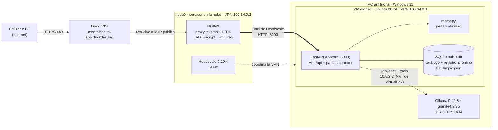

# Pulso · Aptitudes y vacantes

Pulso es una aplicación web con IA que **evalúa aptitudes y recomienda vacantes**. Una persona contesta una prueba corta de 8 aptitudes, el sistema calcula su perfil y le muestra las 5 vacantes que mejor encajan, con sus fortalezas y brechas. Si pulsa «¿Por qué?», un modelo de lenguaje local (Ollama) consulta al motor con herramientas (*tools*) y lo explica en palabras sencillas.

Práctica integradora «IA e infraestructura de red», materia Inteligencia Artificial. Entrega: 23 de octubre de 2026.

> **Aviso de uso.** Esta prueba es una orientación, no una evaluación profesional validada, y no decide una contratación. Las preguntas de escala son autoevaluación. Las vacantes son datos de ejemplo.

## Para quién y qué problema resuelve

| | |
|---|---|
| **Usuario final** | Personas que buscan su primer empleo o quieren cambiar de área (estudiantes, recién egresados) |
| **Problema** | No saben para qué puestos tienen mejores aptitudes ni qué mejorar; las bolsas de trabajo solo filtran por palabras clave |
| **Solución** | Prueba breve → perfil de 8 aptitudes → 5 vacantes con porcentaje de afinidad explicable → explicación con IA y módulo de apoyo emocional durante la búsqueda |

Más detalle en la [idea de negocio](documentacion/idea_de_negocio.md).

## Arquitectura de red



| Equipo | IP | Qué corre | Puertos abiertos |
|---|---|---|---|
| `nodo0` (nube) | VPN `100.64.0.2` | NGINX + Certbot, Headscale | 22, 80, 443, 8080; VPN por `tailscale0`, `wg0`, 51820/udp y 41641/udp |
| VM `alonso` (1 núcleo, 1.5 GB) | VPN `100.64.0.1` | FastAPI + pantallas, motor y SQLite | 8000 **solo** desde `tailscale0` |
| PC anfitriona (Windows) | Sin IP pública ni VPN | Ollama con `granite4.2:3b` | Ninguno: Ollama escucha solo en `127.0.0.1` |

Ollama nunca queda expuesto: ni a Internet ni a la VPN. Solo NGINX y Headscale son públicos. Ollama corre en la PC anfitriona, y no dentro de la VM, porque la PC tiene 7.2 GB de RAM: dentro de la VM una explicación tardaba más de 7 minutos; en la anfitriona tarda de 17 a 42 s.

## Cómo instalar y correr

**Encender y apagar la versión publicada:** doble clic en `deploy/windows/levantar_pulso.bat` o `apagar_pulso.bat`. Guía paso a paso: [deploy/windows/GUIA_ENCENDER_APAGAR.md](deploy/windows/GUIA_ENCENDER_APAGAR.md).

Requisitos: Python 3.11+, Node.js 20.19+ o 22.12+, y Ollama con un modelo que soporte *tools*.

```bash
# Frontend
npm ci
npm test            # pruebas del frontend (node --test)
npm run build       # genera dist/, que sirve FastAPI

# Backend
cd backend
python -m venv .venv
.venv/bin/pip install -r requirements.txt        # en Windows: .venv\Scripts\pip
cp .env.example .env
python validar_datos.py                          # revisa preguntas.json y vacantes.json
python -m pytest -q                              # pruebas del backend
uvicorn main:app --host 127.0.0.1 --port 8000    # abre http://127.0.0.1:8000
```

Para desarrollar las pantallas con recarga en vivo: deja uvicorn corriendo y en otra terminal `npm run dev` (Vite manda `/api` al puerto 8000).

### Variables de entorno (`backend/.env`)

| Variable | Por defecto | Para qué |
|---|---|---|
| `OLLAMA_URL` | `http://localhost:11434` | Dónde está Ollama; en la VM es `http://10.0.2.2:11434` (la PC anfitriona) |
| `OLLAMA_MODELO` | `granite4.2:3b` | Modelo que aparece en `ollama list` |
| `OLLAMA_TIMEOUT` | `120` | Segundos máximos por explicación |
| `PULSO_DIST` | `../dist` | Carpeta del build de las pantallas |

El despliegue completo (VM, systemd, UFW, NGINX) está en [deploy/README.md](deploy/README.md).

## API

| Endpoint | Recibe | Devuelve |
|---|---|---|
| `GET /api/salud` | — | `{"ok": true}` |
| `GET /api/salud/ollama` | — | Si Ollama responde y tiene el modelo |
| `GET /api/prueba` | — | Aptitudes y 24 preguntas, **sin** la respuesta correcta |
| `POST /api/evaluar` | `{"respuestas": {"1": 2, "10": 4, ...}}` | `{"perfil": {"A1": 75, ...}, "recomendaciones": [5 vacantes]}` |
| `POST /api/explicar` | `{"vacante_id": "V01", "perfil": {...}}` | `{"texto", "fuente": "ia" \| "plantilla", "herramientas"}` |
| `GET /api/vacantes` | — | Catálogo de 20 vacantes |
| `POST /api/apoyo` | `{"texto": "..."}` (máx. 500) | `{"tag", "respuesta", "similitud", "crisis"}` |
| `GET /api/reportes/resumen` | `?desde=AAAA-MM-DD&hasta=AAAA-MM-DD` (opcional) | Totales, promedio por aptitud, evaluaciones por día, vacantes más recomendadas, uso de la IA |
| `GET /api/reportes/evaluaciones.csv` | Mismo filtro | Una fila anónima por evaluación |

Validaciones: escala de 1 a 5, opción dentro del rango, todas las respuestas, perfil de 0 a 100, campos extra rechazados (no se aceptan datos personales). Los errores son `422`/`404` con un mensaje en español y el servicio no se cae. Documentación interactiva en `/api/docs`.

## Base de datos (SQLite) y reportes

Pulso usa **SQLite** (`backend/datos/pulso.db`, módulo `backend/db.py`): un solo archivo, sin servidor encendido, incluido en Python. Al arrancar, la API crea las tablas, copia el catálogo desde `preguntas.json` y `vacantes.json` (los archivos que editan los roles 2 y 3) y desde ahí lee aptitudes, preguntas y vacantes.

| Tabla | Qué guarda |
|---|---|
| `aptitudes`, `preguntas` | Las 8 aptitudes y las 24 preguntas (opciones y respuesta correcta en el servidor) |
| `vacantes`, `requisitos` | Las 20 vacantes y su mínimo y peso por aptitud |
| `evaluaciones` | Una fila por prueba terminada: **solo el día** (hora de México) |
| `evaluacion_aptitudes` | El puntaje de 0 a 100 de cada aptitud de esa evaluación |
| `evaluacion_recomendaciones` | Las 5 vacantes recomendadas, su posición y afinidad |
| `explicaciones` | Cada «¿Por qué?»: vacante, fuente (`ia` o `plantilla`) y segundos |

**Privacidad:** no se guarda el alias, las respuestas individuales, la IP ni nada del módulo de apoyo; ninguna tabla tiene columnas para eso (lo comprueba `backend/tests/test_db.py`).

**Reportes:** la pestaña «Reportes» muestra evaluaciones, porcentaje de explicaciones con IA, tiempo promedio de la IA, vacante más recomendada, promedio por aptitud, evaluaciones por día y la tabla de vacantes, con filtro de fechas y descarga en CSV. Para pedir una clave, define `REPORTES_CLAVE` en `backend/.env`; sin ella, los reportes están abiertos porque solo muestran datos anónimos y agregados.

## El motor de afinidad

**8 aptitudes:** A1 Razonamiento lógico, A2 Razonamiento numérico, A3 Comunicación, A4 Trabajo en equipo, A5 Organización y planeación, A6 Resolución de problemas, A7 Atención al detalle, A8 Servicio al cliente. Se miden con 24 preguntas (3 por aptitud): opción múltiple en A1, A2, A3, A6 y A7, y escala del 1 al 5 en A4, A5 y A8 (una invertida por aptitud).

**Perfil:** opción múltiple = 100 si acierta, 0 si falla. Escala = `(valor − 1) / 4 × 100`; si es invertida, primero `valor = 6 − valor`. Se promedian las preguntas de cada aptitud.

**Afinidad con una vacante:**

```
cumplimiento = min(perfil_de_la_aptitud / mínimo, 1)
afinidad     = 100 × Σ(peso × cumplimiento) / Σ(peso)
```

Cada vacante tiene aptitudes clave (peso 3, mínimo 60) y de apoyo (peso 2 con mínimo 50, o peso 1 con mínimo 40). Si el perfil alcanza el mínimo, es **fortaleza**; si no, **brecha**. Los empates se ordenan por el promedio ponderado del perfil.

**Ejemplo resuelto** (está como prueba automática en `backend/tests/test_motor.py`):

| Aptitud | Perfil | Mínimo | Cumplimiento | Peso | Aporta |
|---|---|---|---|---|---|
| A1 | 75 | 60 | 1.00 | 3 | 3.00 |
| A6 | 45 | 60 | 0.75 | 3 | 2.25 |
| A3 | 80 | 40 | 1.00 | 1 | 1.00 |

100 × 6.25 / 7 = 89.3 → **89 %**. Fortalezas: A1 y A3. Brecha: A6.

## Cómo se usa Ollama y su tool

La regla es **«el motor calcula, la IA solo explica»**. `backend/ia.py` sigue el mismo patrón que el agente del clima del equipo (tool calling con `/api/chat`, `think: false` y mensajes `role: tool`):

1. El prompt **no** lleva números: solo pide explicar la vacante `V01`.
2. El modelo llama a las tools que ejecuta el backend:
   - `calcular_afinidad(vacante_id)`: corre `afinidad()` del motor con el perfil de la petición (el modelo no puede mandar ni cambiar el perfil) y devuelve puntaje, fortalezas y brechas con nombre.
   - `obtener_vacante(vacante_id)`: título, área, descripción y habilidades clave.
3. Máximo 3 llamadas a tools; solo se acepta la vacante pedida.
4. Se usa la **plantilla** (`fuente: "plantilla"`) si Ollama no responde, tarda más de 120 s, el modelo no soporta tools, no consultó al motor o escribe un porcentaje distinto al del motor.
5. Las explicaciones de IA se guardan en memoria por perfil y vacante.

La pantalla muestra «Generada con IA» o «Explicación automática» y qué tools usó el modelo.

## Cómo se usa el dataset (módulo de apoyo)

`KB_limpio.json` (dataset de la lista del profesor: 79 tags, 3,139 frases, casi todo en inglés) no sirve para medir aptitudes, pero sí para acompañar a quien busca empleo. La sección **«Apoyo en la búsqueda de empleo»**:

- Usa solo los tags útiles: `problem`, `stressed`, `anxious`, `scared`, `sad`, `worthless`, `depressed`, `sleep`, `no-approach`, `learn-more`, `meditation`, `user-advice`, `help`, `fact-*` y `suicide`. Los tags sobre el propio chatbot quedan fuera.
- Compara el texto con TF-IDF y similitud coseno contra las frases en inglés, sus traducciones al español (`src/data/KB_es.json`) y 21 frases semilla del equipo sobre entrevistas y rechazo (`backend/datos/apoyo_semillas.json`, solo para buscar).
- Responde con la traducción al español del dataset. Si la similitud es menor a 0.30, da un mensaje general y no inventa.
- Si detecta crisis (tag `suicide` o frases como «quitarme la vida», «no quiero vivir»), muestra siempre la Línea de la Vida (800 911 2000) y el 911.
- **Nunca** afecta el perfil ni las recomendaciones, no guarda el texto, no lo registra (NGINX tiene `access_log off` en esa ruta) y el reclutador nunca lo ve. Usar información emocional para decidir un empleo sería discriminatorio.

## Configuración del proxy (fragmento de `deploy/nginx/pulso.conf`)

```nginx
limit_req_zone $binary_remote_addr zone=pulso_ia:10m rate=6r/m;
upstream pulso_app { server IP_VPN_DE_LA_VM:8000; }   # la VM, por la VPN

server {
    listen 443 ssl;
    server_name TU_SUBDOMINIO.duckdns.org;
    ssl_certificate     /etc/letsencrypt/live/TU_SUBDOMINIO.duckdns.org/fullchain.pem;
    ssl_certificate_key /etc/letsencrypt/live/TU_SUBDOMINIO.duckdns.org/privkey.pem;

    proxy_set_header Host $host;
    proxy_set_header X-Real-IP $remote_addr;
    proxy_set_header X-Forwarded-For $proxy_add_x_forwarded_for;
    proxy_set_header X-Forwarded-Proto $scheme;
    proxy_read_timeout 120s;

    location = /api/explicar { limit_req zone=pulso_ia burst=3 nodelay; proxy_pass http://pulso_app; }
    location = /api/apoyo    { access_log off; limit_req zone=pulso_ia burst=5 nodelay; proxy_pass http://pulso_app; }
    location /               { proxy_pass http://pulso_app; }
}
```

El puerto 80 redirige a 443. Esta configuración reemplaza a la anterior, que mandaba todo a `danielserv:11434` sin autenticación.

## Uso responsable

- Como máximo un alias opcional, que no sale del navegador. Sin correo, teléfono ni dirección. **No se guarda nada**: el perfil se calcula y se muestra.
- No se usan edad, género, estado civil ni origen.
- El modelo de lenguaje nunca calcula ni cambia puntajes; si escribe otro porcentaje, se descarta.
- Es una orientación, no una prueba validada, y no decide contrataciones. Las escalas son autoevaluación y tienden a inflarse.
- El módulo de apoyo no es atención profesional y está separado de la evaluación.

## Pruebas

| Comando | Qué cubre |
|---|---|
| `npm test` | Lógica de pantallas, 8 aptitudes, traducciones del dataset |
| `python -m pytest -q` | Motor (ejemplo de 89 %, invertidas, mínimo en cero, 3 perfiles), API y validaciones, Ollama simulado con tools, Ollama apagado, porcentaje equivocado, módulo de apoyo y crisis |
| `python backend/validar_datos.py` | JSON válidos, preguntas por aptitud, `correcta` en rango, pesos mayores que cero |

Resultados y evidencias en [documentacion/verificacion.md](documentacion/verificacion.md).

## Herramientas de desarrollo

El proyecto se desarrolló en **Antigravity** con **Claude Code** en su terminal integrada (generación de código, pruebas y documentación), revisado y ajustado por el equipo. Frontend: React 19 + Vite 6. Backend: FastAPI + httpx. IA: Ollama 0.40.8 con `granite4.2:3b`. Infraestructura: Headscale/Tailscale, NGINX, Certbot y DuckDNS.

## Equipo y SCRUM

| Rol | Integrante | Qué hizo |
|---|---|---|
| 1. Líder, Scrum Master y Product Owner | _(nombre)_ | Alcance, backlog, tablero, documentación y presentación |
| 2. Contenido | _(nombre)_ | Aptitudes, preguntas, requisitos de vacantes y avisos |
| 3. Datos e IA | _(nombre)_ | Catálogo de vacantes, motor y prompts/tools de Ollama |
| 4. Backend e infraestructura | _(nombre)_ | API, VPN, Ollama, NGINX y despliegue |
| 5. Frontend y UX | _(nombre)_ | Pantallas, gráfica de aptitudes y lista de vacantes |

Backlog, Sprints y retrospectiva: [documentacion/scrum.md](documentacion/scrum.md). Guion del video: [documentacion/guion_video.md](documentacion/guion_video.md).
